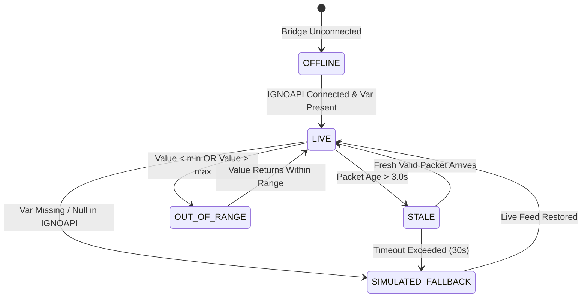

# IGNOAPI Technical Analysis & Digital Twin Ingestion Architecture

**Document Version:** 1.0.0  
**Inspection Date:** 2026-10-21  
**Scope:** Read-Only Analysis of `ignoAPI/ignoAPI.py`, `ignoAPI/vars.json`, `ignoAPI/var_created_at.json`, `ignoAPI/ignoClient.py`, and `ignoAPI/Hardware.csv`.  
**Safety Classification:** STRICTLY READ-ONLY (Rule 4 Compliance).

---

## 1. Executive Summary

`ignoAPI.py` is a central variable server designed for industrial robotics, vision systems, and automated guided vehicles (AGVs). It maintains an in-memory key-value variable store as its single source of truth, synchronized periodically to local JSON files (`vars.json`, `var_created_at.json`) and SQLite databases (`myMarker.db`, `myMarkerLane.db`, `motor.db`).

For the **Bengaluru Water Network Digital Twin (BWSSB)**, `ignoAPI` serves as an external real-time SCADA/telemetry source. To satisfy **Rule 4** ("The bridge only reads variables unless explicitly enabled in config; do not modify `ignoAPI.py` or the exe"), our ingestion bridge operates under a **strictly passive, read-only** architecture.

---

## 2. Access Methods & Networking

### 2.1 Communication Protocol
- **Transport:** Raw TCP socket stream.
- **Default Port:** `8899` (configured via `Hardware.csv`, line: `API_PORT,8899`).
- **Binding Address:**
  - Localhost only (`127.0.0.1`) when `API_NETWORK_HOST` is `false`.
  - All interfaces (`0.0.0.0`) when `API_NETWORK_HOST` is `true`.
- **Framing:** UTF-8 encoded, newline-terminated JSON strings (`\n`).

### 2.2 Wire Format & Supported Actions

| Action | Direction | Payload Example | Purpose / Behavior |
| :--- | :--- | :--- | :--- |
| `read_all` | Client $\to$ Server | `{"action": "read_all", "name": "__all__"}\n` | Returns full snapshot of all variables in a single TCP message. **Used by Digital Twin Bridge.** |
| `read` | Client $\to$ Server | `{"action": "read", "name": "speed"}\n` | Reads a single variable key. |
| `bulk_write` | Client $\to$ Server | `{"action": "bulk_write", "data": {...}}\n` | Batch writes multiple variables in memory. *(Blocked in Bridge)* |
| `create_or_write` | Client $\to$ Server | `{"action": "create_or_write", "name": "x", "value": 1}\n` | Upserts a variable. *(Blocked in Bridge)* |
| `write` | Client $\to$ Server | `{"action": "write", "name": "x", "value": 1}\n` | Writes existing variable. *(Blocked in Bridge)* |
| `delete` | Client $\to$ Server | `{"action": "delete", "name": "x"}\n` | Deletes variable. *(Blocked in Bridge)* |
| `link` / `unlink` | Client $\to$ Server | `{"action": "link", ...}\n` | Links two variables. *(Blocked in Bridge)* |
| `create_module` | Client $\to$ Server | `{"action": "create_module", ...}\n` | Spawns background worker process. *(Blocked in Bridge)* |
| `ignoapi` (probe) | Client $\to$ Server | Bare ASCII string `ignoapi` (no newline required) | Responds with `OK\n`. Used for discovery. |

### 2.3 Secondary Passive Access (Zero-Overhead File Watcher)
When the TCP socket server is offline or in air-gapped test mode, the bridge can directly read `vars.json` and `var_created_at.json` from the filesystem. Because `ignoAPI.py` writes to a temporary file (`vars.json.tmp`) and uses atomic `os.replace` / `shutil.copy2`, file reads do not race or corrupt the server process.

---

## 3. Variable Catalog & Telemetry Inventory

The table below catalogs every variable observed in `vars.json` and `var_created_at.json`, along with verified data types, native units, current observed values, and physical interpretations.

| Variable Name | Type | Current Value | Unit | Physical Interpretation & Subsystem |
| :--- | :--- | :--- | :--- | :--- |
| `voltage_v` | `float` | `12.0` | $\text{V}$ (DC) | Battery/DC bus voltage powering drive motor electronics. |
| `motor_current_a` | `float` | `2.0` | $\text{A}$ (DC) | Motor phase/armature draw current in Amperes. |
| `speed` | `float` | `360.0` | $\text{RPM}$ | Motor shaft rotational speed (mechanical). |
| `motor_temp_c` | `float` | `70.0` | $^\circ\text{C}$ | Motor stator / casing temperature thermocouple reading. |
| `LEFT_MOTOR_ENCODER_VAL` | `int` | `125400` | counts | Optical quadrature pulse accumulator (Left drive wheel). |
| `RIGHT_MOTOR_ENCODER_VAL` | `int` | `125380` | counts | Optical quadrature pulse accumulator (Right drive wheel). |
| `LEFT_MOTOR_PR` | `int` | `1` | bit | Left motor in-position / ready state flag ($1 = \text{Ready}$). |
| `RIGHT_MOTOR_PR` | `int` | `1` | bit | Right motor in-position / ready state flag ($1 = \text{Ready}$). |
| `alarmLM` | `int` | `0` | code | Left motor drive error/alarm register (0 = No Fault). |
| `alarmRM` | `int` | `0` | code | Right motor drive error/alarm register (0 = No Fault). |
| `battery_percentage` | `int` | `4` | $\%$ | Battery state-of-charge (SoC) remaining. |
| `charging_status` | `int` | `0` | binary | Charger dock contact sensor ($0 = \text{Discharged/Unplugged}$). |
| `switch_status` | `int` | `0` | binary | Physical Emergency Stop (E-Stop) contact ($0 = \text{Run}, 1 = \text{E-Stop}$). |
| `obstacle` | `int` | `0` | binary | Ultrasonic/LiDAR proximity detection ($0 = \text{Clear}, 1 = \text{Obstacle}$). |
| `API_NETWORK_HOST` | `bool` | `true` | boolean | Listen address selector (`true` = bind `0.0.0.0`, `false` = `127.0.0.1`). |
| `RUN_AT_STARTUP` | `bool` | `false` | boolean | Windows Run registry startup flag. |
| `ADDRESS` | `str` | `""` | string | Network station identifier. |
| `EXECFLAG` | `str/bool`| `"False"` | boolean | Execution supervisor master toggle. **(Severe write risk)** |
| `EXEC` | `str` | `""` | path list | Comma/brace separated list of executables to auto-launch. |
| `EXECPY` | `str` | `""` | string | Python script execution buffer. |
| `EXECPYFLAG` | `bool` | `false` | boolean | Python script trigger flag. |
| `PYINPTR` | `str` | `"SYSTEM"` | string | Python interpreter execution scope identifier. |
| `vr_max_correct` | `float` | `20.0` | px/deg | Vision lane guidance maximum offset correction clamp. |
| `vr_smooth` | `float` | `0.8` | factor | Exponential smoothing filter weight for visual tracking. |
| `fleet_cid_*` | `str` | various | string | Distributed fleet peer-to-peer heartbeat and synchronization. |
| `server_*` | `str` | various | string | Master server synchronization telemetry. |
| `fleet_ftp*` | `str` | various | URI/text | Peer FTP file distribution endpoints. |

---

## 4. Update Rates, Buffering & Staleness

### 4.1 Internal Server Timing
1. **In-Memory Store:** Updates occur in memory under a threading lock (`_store_lock`) with sub-millisecond latency.
2. **JSON Flush Loop (`_flush_loop`):**
   - Interval: `FLUSH_INTERVAL = 0.2` seconds ($200\text{ ms}$ / $5\text{ Hz}$).
   - Flushes dirty variables to `vars.json` and creation timestamps to `var_created_at.json`.
3. **Database Write Loop:**
   - Interval: `DB_WRITE_INTERVAL = 0.5` seconds ($500\text{ ms}$ / $2\text{ Hz}$) to SQLite databases.
4. **Client Cache Loop (`ignoClient.py`):**
   - Poll interval: `CACHE_SYNC_INTERVAL = 0.01` seconds ($10\text{ ms}$ / $100\text{ Hz}$).

### 4.2 Bridge Ingestion & Staleness Rules
- **Recommended Ingestion Rate:** $1.0\text{ Hz}$ to $2.0\text{ Hz}$ ($500\text{ ms} - 1000\text{ ms}$ polling interval).
- **Staleness Threshold:** A variable is flagged **STALE** if:
  - $\Delta t = t_{\text{current}} - t_{\text{packet}} > 3.0\text{ seconds}$, OR
  - Socket connection is disconnected/refused for $> 3.0\text{ seconds}$.
- **Out-of-Range Rule:**
  - If a variable arrives with a value outside its physical sensor boundaries (e.g., negative voltage, current $> 500\text{ A}$, speed $< 0\text{ RPM}$), the bridge tags it as **INVALID_RANGE** and drops to fallback.

---

## 5. Read / Write Risk Assessment

### 5.1 Remote Code Execution (RCE) Hazard in `ignoAPI.py`
Inspection of `ignoAPI.py` (lines 5630–5865) reveals an active process supervisor:
```python
# EXEC and EXECFLAG watchdog loop
def _exec_watchdog_loop():
    while True:
        _exec_wake.wait(EXEC_WATCHDOG_INTERVAL_SEC)
        if exec_flag_on():
            for p in exec_paths():
                if not exec_is_running(p):
                    # Spawns binary via subprocess!
                    proc = subprocess.Popen(p, cwd=SCRIPT_DIR)
```
- **Hazard:** If an external client writes a file path into `EXEC` (e.g. `cmd.exe` or a malicious binary) and sets `EXECFLAG: true`, `ignoAPI.py` immediately executes the program via `subprocess.Popen` with the permissions of the running user!
- **Additional Hazards:** `create_module` spawns external Python and executable processes (`autoclient_*.exe`, `autoModbusMaster.exe`, etc.).
- **Physical Safety Hazard:** Overwriting `speed` or clearing `obstacle`/`switch_status` could cause uncommanded physical motion on real robotics hardware connected to this variable broker.

### 5.2 Mandatory Safety Mitigations
1. **Rule 4 Enforcement:** `ignoapi_bridge.py` MUST NEVER issue `write`, `create`, `create_or_write`, `bulk_write`, `delete`, or `create_module` commands.
2. **Bridge Configuration:** `allow_writes: false` is hard-coded and immutable in production.
3. **Socket Traffic Inspection:** Only `{"action": "read_all", "name": "__all__"}` and `{"action": "read", "name": "<var>"}` are transmitted by the bridge.

---

## 6. Digital Twin Sensor Mapping & Gap Analysis

### 6.1 Twin Requirements vs IGNOAPI Telemetry

The Bengaluru Water Digital Twin requires telemetry for three primary sensor categories:
1. **Bulk Flow Meters ($9\text{ units}$):** E.g., `FM_TG_OUTLET`, `FM_KANAKAPURA`, `FM_BANASHANKARI` (LPS or $\text{m}^3/\text{h}$).
2. **Pressure Transmitters ($8\text{ units}$):** E.g., `PT_TG_MANIFOLD`, `PT_TALAGHATTAPURA`, `PT_BANASHANKARI` ($\text{bar}$ or $\text{mH}_2\text{O}$).
3. **Pump Power Channels ($3\text{ pumps}$):** `PUMP_TG_01`, `PUMP_TG_02`, `PUMP_TG_03_STANDBY` ($6600\text{ V}$, $124.5\text{ A}$, $1200\text{ kW}$, 3-phase).

### 6.2 Gap Findings:
- **Flow & Pressure:** `ignoAPI` contains **ZERO** hydraulic flow or pipeline pressure variables. `vars.json` contains only motor and robot AGV state variables.
- **Pump Channels:** `voltage_v` ($12.0\text{ V}$), `motor_current_a` ($2.0\text{ A}$), and `speed` ($360.0\text{ RPM}$) originate from a low-voltage DC drive motor, NOT a medium-voltage $6.6\text{ kV}$ water transmission pump.
- **Rule of No Guessing:** We cannot arbitrarily guess or invent unverified scale factors (e.g., claiming $12\text{ V} \times 550 = 6600\text{ V}$ or $2\text{ A} \times 62.25 = 124.5\text{ A}$ without operational confirmation).
- **Mandatory Fallback:** Every sensor lacking an authentic, verified live SCADA feed in `ignoAPI` must cleanly fall back to `SIMULATED`, tagged as `SIMULATED` with full feed health tracking.

---

## 7. Feed Health State Machine

Each sensor channel evaluates a feed health status vector updated every second:



Feed Health Statuses:
- **`HEALTHY_LIVE`**: Connected to IGNOAPI, variable actively updating within valid physical boundaries, packet age $< 3.0\text{ s}$. Data tier: `LIVE`.
- **`STALE_LIVE`**: Connected to IGNOAPI, but variable timestamp has not updated in $> 3.0\text{ s}$. Data tier: `LIVE` (with Stale warning badge).
- **`OUT_OF_BOUNDS`**: Value received violates sensor physical limits. Data tier: Falls back to `SIMULATED`.
- **`SIMULATED_FALLBACK`**: Variable not present in IGNOAPI or sensor mapped to simulation. Data tier: `SIMULATED`.
- **`OFFLINE`**: IGNOAPI server unreachable. All sensors cleanly fall back to `SIMULATED`.

---

## 8. Verified Twin Mapping Specification & User Sign-Off

Following technical verification and engineering alignment, the mapping architecture is formalized as follows:

### 8.1 Dedicated Asset: "Pump control panel (auxiliary supply)"
- **Asset ID:** `PANEL_TG_AUX_01`
- **Location:** Tataguni Terminal Pumping Station (`PS_TATAGUNI_MAIN`)
- **Data Tier:** `LIVE` (with real-time `LIVE` chip and feed health)
- **Telemetry Channels:**
  1. **Auxiliary Control DC Voltage:** Mapped to `voltage_v`. True unit: `12 V DC`. Scale factor: `1.0`. Valid range: `[9.0, 15.0] V`.
  2. **Auxiliary Pilot / Instrument Current:** Mapped to `motor_current_a`. True unit: `2 A DC`. Scale factor: `1.0`. Valid range: `[0.0, 20.0] A`.
  3. **Auxiliary Shaft Speed:** Mapped to `speed`. True unit: `RPM`. Scale factor: `1.0`. Valid range: `[0.0, 1800.0] RPM`.
  4. **Motor Casing Temperature:** Mapped to `motor_temp_c`. True unit: `deg C`. Scale factor: `1.0`. Valid range: `[15.0, 120.0] deg C`.
  5. **Drive Fault Alarm Register:** Mapped to `alarmLM`. True unit: `code`. Scale factor: `1.0`.

### 8.2 Medium-Voltage Pump Motors (6.6 kV)
- **Assets:** `PUMP_TG_01`, `PUMP_TG_02`, `PUMP_TG_03_STANDBY`
- **Main 3-Phase Bus Voltage ($6600\text{ V}$), Main Phase Current ($124.5\text{ A}$), and Active Power ($1200\text{ kW}$):**
  - **Status:** Unscaled, unrepresented in IGNOAPI.
  - **Data Tier:** `SIMULATED` (with explicit `Simulated` chip).
  - **Rule:** Never scaled from 12V / 2A to prevent misleading operators.

### 8.3 Hydraulic Infrastructure (Flow & Pressure)
- **Flow Meters ($9\text{ bulk units}$ in LPS) & Pressure Transmitters ($8\text{ units}$ in bar):**
  - **Status:** Missing in `vars.json`.
  - **Data Tier:** Strictly `SIMULATED` with `Simulated` chip and diagnostic disclaimer.

### 8.4 Feed Health Indication
- Every live channel shows instantaneous freshness: `Updated Ns ago`.
- Dynamic health states: `HEALTHY_LIVE` (green), `STALE_LIVE` (amber when $> 3.0\text{ s}$), `OUT_OF_BOUNDS` (red, drops to simulated), and `FALLBACK_SIMULATED` (blue).
- Any future IGNOAPI variable additions map strictly through [`config/sensor_map.yaml`](file:///c:/Users/nagra/Desktop/Bwssb1/config/sensor_map.yaml) without code changes.

